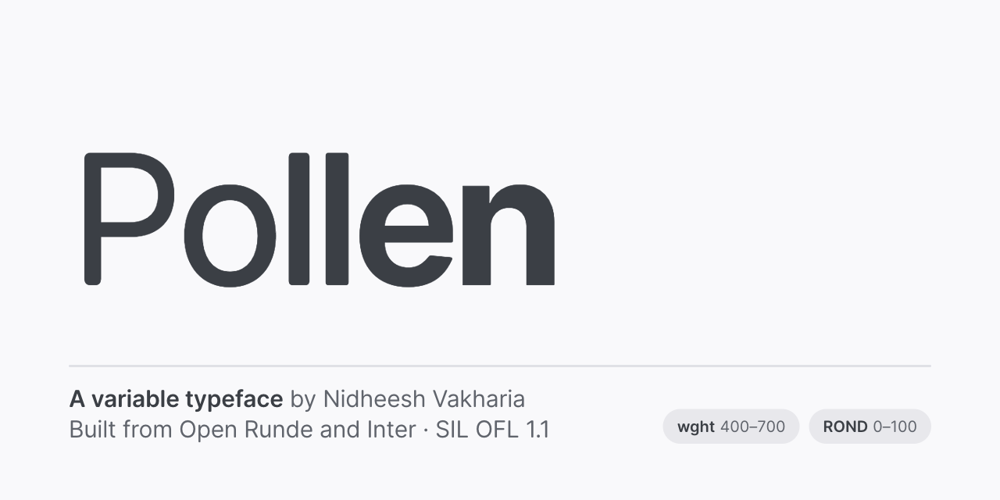

<p align="center">
  
</p>

# Pollen

A free variable typeface by Nidheesh Vakharia. One file, two axes:

| Axis | Tag | Range | Default |
|------|-----|-------|---------|
| Weight | `wght` | 400–700 | 400 |
| Roundness | `ROND` | 0–100 (sharp → soft) | 100 |

## Built on Open Runde and Inter

Pollen is a modified version of **[Open Runde](https://github.com/lauridskern/open-runde)** by Laurids Kern, which is a rounded take on **[Inter](https://github.com/rsms/inter)** by Rasmus Andersson. The letterforms are theirs. Pollen joins Open Runde's four static weights into one variable font and adds a roundness axis.

If you like Pollen, go star the originals. Neither author is affiliated with Pollen or endorses it.

## Use it

Grab [`fonts/Pollen[ROND,wght].woff2`](fonts/) (or the `.ttf` for desktop apps).

```css
@font-face {
  font-family: "Pollen";
  src: url("Pollen[ROND,wght].woff2") format("woff2");
  font-weight: 400 700;
}

h1 {
  font-family: "Pollen", sans-serif;
  font-weight: 560;
  font-variation-settings: "ROND" 40;
}
```

## License

[SIL Open Font License 1.1](OFL.txt), the same license as Inter and Open Runde. You can use, modify and share Pollen, including in commercial work. You can't sell the font files on their own, and copies must keep the copyright notices and the license.

Copyright 2016 The Inter Project Authors · 2023 Laurids Kern · 2026 Nidheesh Vakharia

---

Building the font or working on the specimen site? See [CONTRIBUTING.md](CONTRIBUTING.md).
